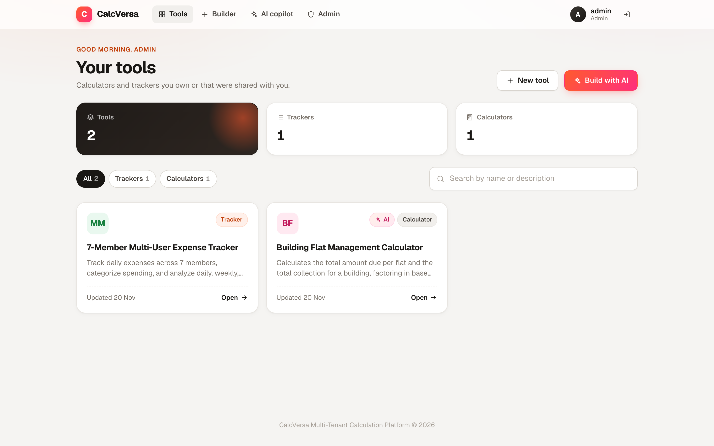
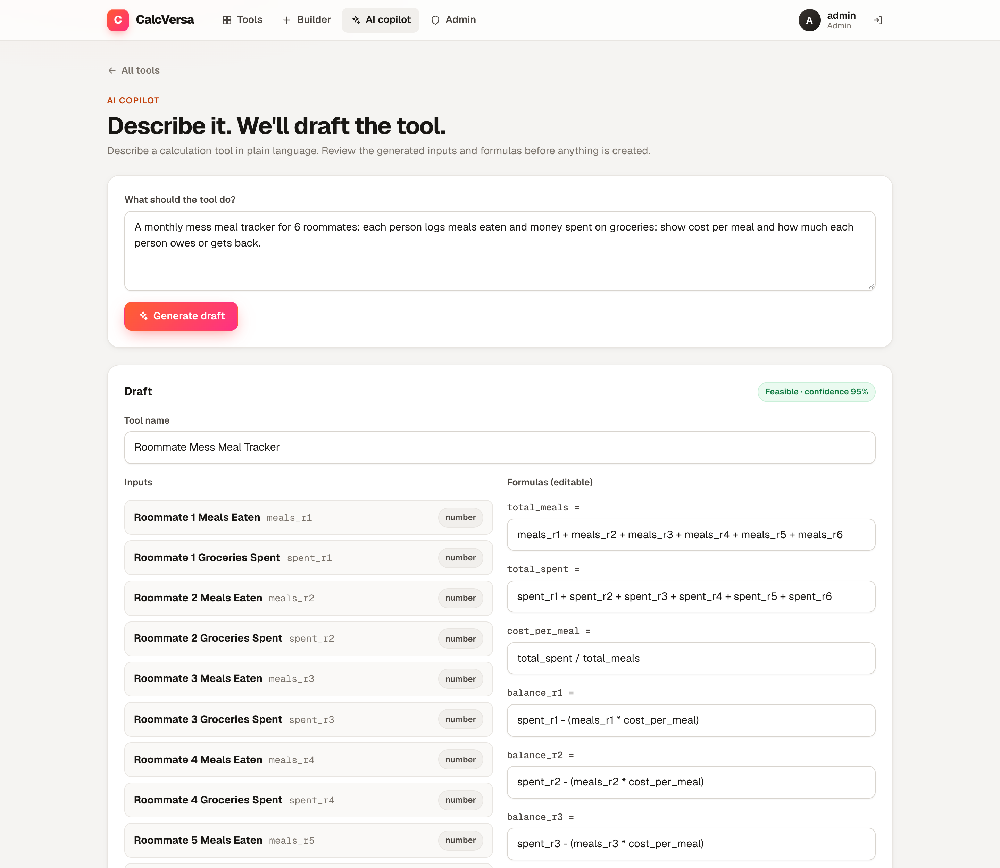
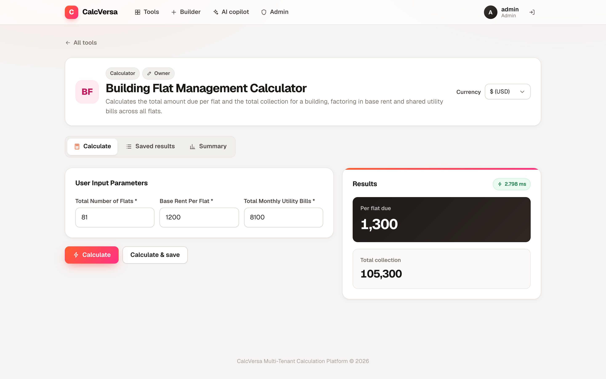
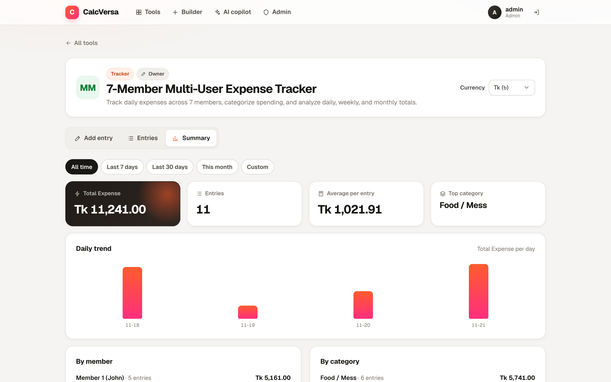
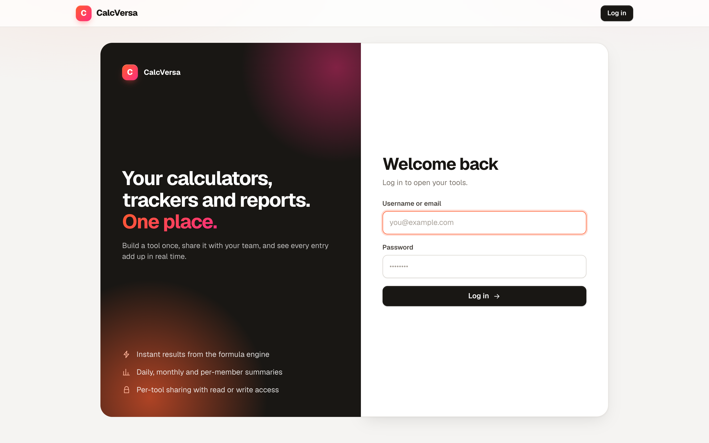

# CalcVersa

> Multi-tenant, polyglot microservices platform enabling accounts to define custom calculation tool requirements and serve account-specific calculation tools under dedicated URLs (e.g. `<base-url>/product?id=<tool-id>`).



**All your tools in one place.** Find any calculator or tracker in seconds, build a new one yourself, or simply describe what you need and let AI create it.

### AI-powered: describe it, get a working tool

[](docs/assets/screenshot-ai-copilot.png)

Write what you need in everyday words, like *"a meal tracker for 6 roommates that shows cost per meal and who owes what"*, and the AI assistant designs the whole tool for you:

- **Builds it for you.** It works out which details to ask for, how to calculate the results, and even names the tool.
- **Explains itself.** It tells you how the tool works and how confident it is, so you know what you're getting.
- **You stay in control.** Review and adjust any calculation before anything is created; nothing is saved until you approve it.
- **Safe by design.** Every AI-made calculation is checked before it can run, and AI-made tools are clearly marked on your dashboard.

| Instant answers | Know where the money goes | Your tools, your people |
| :---: | :---: | :---: |
| [](docs/assets/screenshot-calculator.png) | [](docs/assets/screenshot-summary.png) | [](docs/assets/screenshot-login.png) |
| Enter a few numbers and get results right away: rent per flat, loan payments, or any calculation you set up. | Record daily expenses and see totals, trends, top categories and who spent what, for any period. | Every account gets its own private tools, and you decide who can view or edit each one. |

---

## 100% Docker-Powered Architecture

No local runtime setup (Node.js, Go, Python, PostgreSQL, Nginx, RabbitMQ) is required! The entire polyglot backend stack and React SPA frontend run in **Docker Compose** with multi-stage builds and dedicated non-conflicting host ports.

### Start the Platform

First create the Compose env file and set a `JWT_SECRET` of at least 32 characters (e.g. `openssl rand -hex 48`). The file is gitignored:

```bash
cp infra/docker/.env.example infra/docker/.env
```

Then start all microservices and the frontend from the project root:

```bash
docker compose -f infra/docker/docker-compose.yml up -d
```

To stop all containers:
```bash
docker compose -f infra/docker/docker-compose.yml down
```

---

## Local Service Directory & Active Container URLs

| Application / Microservice | Local Host URL | Container Name | Description |
| :--- | :--- | :--- | :--- |
| **React Frontend SPA** | **`http://localhost:4200/`** | `calcversa-frontend` | Production Nginx container serving React SPA |
| ↳ **Tools Dashboard** | **`http://localhost:4200/`** | `calcversa-frontend` | Manage, search, and launch calculation tools |
| ↳ **Dynamic Tool Runner** | **`http://localhost:4200/product?id=<id>`** | `calcversa-frontend` | Dedicated product URL with dynamic inputs & <0.2ms Go math execution |
| ↳ **AI Prompt Copilot** | **`http://localhost:4200/ai-copilot`** | `calcversa-frontend` | Natural language prompt-to-tool generator with Gemini 2.5 Flash |
| ↳ **Creative Tool Builder** | **`http://localhost:4200/create`** | `calcversa-frontend` | Visual form field constructor with live preview |
| **Admin Management Panel** | **`http://localhost:3005/admin`** | `calcversa-api-gateway` | Super-Admin console: users, roles, tools and recent records |
| **API Gateway & Swagger UI** | **`http://localhost:3005/api/docs`** | `calcversa-api-gateway` | REST APIs & interactive OpenAPI documentation (`/auth`, `/apps`, `/records`) |
| **AI Assistant Microservice** | **`http://localhost:3006/agent/feasibility`** | `calcversa-ai-assistant` | AI guidance, safety guardrails, and RAG tool generation |
| **Go Compute Engine** | **`http://localhost:8085/health`** | `calcversa-compute-service` | Real-time mathematical formula evaluation engine (<0.2ms) |
| **RabbitMQ Dashboard** | **`http://localhost:15675`** | `calcversa-rabbitmq` | Event broker management console (`guest` / `guest`) |
| **PostgreSQL Database** | **`localhost:5435`** | `calcversa-postgres` | PostgreSQL DB (`calcversa_user` / `calcversa_pass` / `calcversa`) |

---

## Accessing the Admin Management Panel

The Admin Panel at `http://localhost:3005/admin` requires an account with **`is_admin = true`**.

### How to Promote a User to Admin:

Run this command from your terminal to promote any registered user account (e.g., `johndoe`) to Admin:

```bash
docker exec -it calcversa-postgres psql -U calcversa_user -d calcversa -c "UPDATE users SET is_admin = true WHERE username = 'johndoe';"
```

---

## Database Schema & Sample Data

The schema is managed by **TypeORM migrations** (`libs/db/src/migrations/`). The API Gateway applies pending migrations on start-up; databases created earlier with auto-sync are detected and upgraded automatically.

To load the sample 7-member expense tracker and an admin account (`admin`, password in `libs/db/src/seeds/seed-expense-tracker.ts`; local use only):

```bash
npx ts-node -P libs/db/tsconfig.json libs/db/src/seeds/seed-expense-tracker.ts
```

---

## Container Log Access

Log files stream directly inside container volumes:

- **API Gateway**: `./backend/api-gateway-nodejs/logs/`
- **AI Assistant**: `./backend/ai-assistant-service-nodejs/logs/`
- **Compute Engine**: `./backend/compute-service-golang/logs/`
